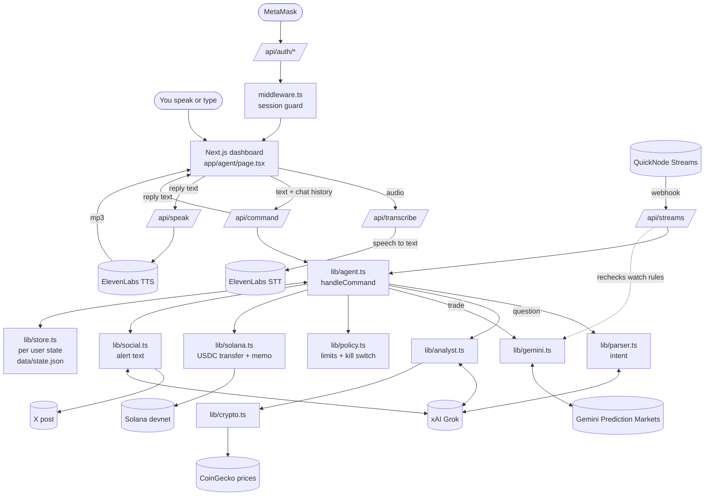
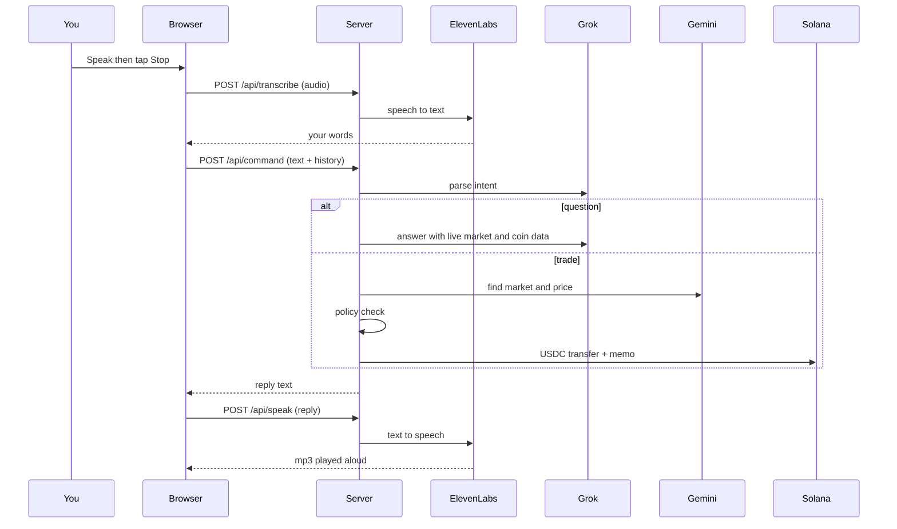

# VoiceBet Agent

**Say the bet. Your agent does the rest.**

VoiceBet is a voice controlled AI agent. It holds a USDC budget on Solana and trades Gemini Prediction Markets for you. You talk to it. It answers in a real voice. Every trade passes a spend policy first and leaves an onchain receipt.

Repo: https://github.com/Prasannaverse13/VoiceBet

Built solo for UBC Hackathon 2026. Track: Agentic Payments and AI. Chain: Solana (devnet).

---

## What it does

- **Talk to it.** Tap the orb and speak. ElevenLabs turns your voice into text.
- **Ask or command.** A question like "What do you think about the crypto markets?" gets an answer. A command like "Bet 10 USDC on yes for bitcoin above 150k" places a trade.
- **It answers in voice.** The reply shows in a chat thread and is read aloud by ElevenLabs.
- **Safe by design.** Per bet limit, daily cap, price ceiling, category list and a kill switch run before any money moves.
- **Proof for every trade.** USDC moves on Solana devnet with a memo receipt you can open in Solana Explorer.
- **Watch rules.** "Put 20 USDC on a Fed cut if odds drop below 40" stores a rule. QuickNode Streams wakes the agent to check it.
- **Sign in with MetaMask.** No password. Each wallet gets its own agent state.

---

## Architecture



### Voice turn step by step



---

## Integrations and where each one lives

| Resource | What we use it for | Files |
| --- | --- | --- |
| **ElevenLabs speech to text** | Turns your recorded voice into text (model `scribe_v2`) | `app/api/transcribe/route.ts` (server call) and `app/agent/page.tsx` (`startMeter`, `finish`: records with MediaRecorder and uploads) |
| **ElevenLabs text to speech** | Reads every reply aloud (model `eleven_flash_v2_5`). Picks a voice a free plan can use | `app/api/speak/route.ts` (server call and voice fallback) and `app/agent/page.tsx` (`speak`, Play and Stop) |
| **xAI Grok** | Turns speech into a JSON intent. Answers questions. Writes the X alert | `lib/parser.ts` (intent), `lib/analyst.ts` (answers), `lib/social.ts` (alert text) |
| **Gemini Prediction Markets** | Live events and prices. Signed orders in live mode | `lib/gemini.ts` (REST calls, order signing, cache), `lib/sample-markets.ts` (demo fallback) |
| **Solana devnet** | USDC SPL transfer with a Memo receipt. Explorer links | `lib/solana.ts`, `scripts/create-wallet.mjs` (makes the agent wallet) |
| **QuickNode Streams** | Webhook that wakes the agent to check watch rules | `app/api/streams/route.ts`, rules logic in `lib/agent.ts` (`evaluateRules`) |
| **MetaMask** | Sign in and sign up with a signed message. Login identity only | `lib/wallet.ts`, `components/ConnectButton.tsx`, `components/Nav.tsx`, `app/api/auth/*` |
| **CoinGecko** | Live coin prices so the AI can answer about Solana and Bitcoin | `lib/crypto.ts`, used in `lib/analyst.ts` |
| **X (Twitter) API** | Posts the trade alert written by Grok | `lib/social.ts` |

### Other important files

| File | Job |
| --- | --- |
| `lib/agent.ts` | The brain loop. Routes a command to trade, status, recap, rule or answer |
| `lib/policy.ts` | Spend rules: per bet max, daily cap, price ceiling, categories, kill switch |
| `lib/store.ts` | Per user state with AsyncLocalStorage. Saved in `data/state.json` |
| `lib/session.ts` and `lib/auth.ts` | Signed session cookie (HMAC SHA 256) and the nonce |
| `middleware.ts` | Blocks `/agent` and `/api/*` without a session |
| `lib/types.ts` | Shared types |
| `app/page.tsx` | Landing page with Connect Wallet |
| `app/agent/page.tsx` | Dashboard: voice orb, chat thread, markets, policy, rules, trades, feed |
| `app/globals.css` | All styles |
| `lib/localStt.ts` | Old in browser Whisper helper. Not used now. Safe to delete |

---

## Sign in

Connect Wallet on the landing page is both sign in and sign up.

1. MetaMask signs a free message. No gas. No funds move.
2. The server checks the signature, the site name and a one time nonce (`/api/auth/nonce`, `/api/auth/verify`).
3. A signed httpOnly cookie starts a 7 day session and you land on `/agent`.
4. Signed out people are sent back to the landing page by `middleware.ts`.
5. Each wallet address gets its own policy, trades, rules and feed.
6. Log out is in the dashboard header. Switching account in MetaMask also logs you out.

The agent trades from one shared Solana devnet wallet. Your MetaMask address is your login identity only.

---

## Spend policy

Checked in `lib/policy.ts` before every trade.

- Max per bet
- Max per day
- Max price you will pay
- Allowed categories
- Kill switch that stops all trading (say "Stop all trading")

---

## Run it

Needs Node 18 or newer.

```bash
npm install
cp .env.example .env            # then fill your keys
npm run wallet                  # creates the devnet agent wallet
npm run dev                     # http://localhost:3000
```

On Windows PowerShell use `copy .env.example .env`.

Fund the printed wallet address on **devnet**:

1. SOL for fees: https://faucet.solana.com (pick Devnet)
2. USDC to trade: https://faucet.circle.com (pick Solana and Devnet)

Check the balance in Solana Explorer with `?cluster=devnet` at the end of the link.

### Environment variables

| Variable | Needed for |
| --- | --- |
| `SESSION_SECRET` | Signs login cookies. Use a long random string |
| `ELEVENLABS_API_KEY` | Voice in and voice out |
| `ELEVENLABS_VOICE_ID` | Optional. Leave empty to use a built in voice |
| `XAI_API_KEY` and `XAI_MODEL` | Grok brain (`grok-3-mini` default) |
| `GEMINI_API_KEY` and `GEMINI_API_SECRET` | Only for live orders. Market data is public |
| `GEMINI_MODE` | `paper` (default) simulates fills. `live` sends signed orders |
| `GEMINI_BASE_URL` | Default `https://api.gemini.com` |
| `SOLANA_RPC_URL` | Default devnet RPC |
| `SOLANA_AGENT_SECRET` | Optional. `npm run wallet` makes `data/agent-wallet.json` |
| `USDC_MINT` | Devnet Circle USDC mint (in `.env.example`) |
| `ESCROW_WALLET` | Optional. Where staked USDC goes |
| `QUICKNODE_STREAM_TOKEN` | Secret for the Streams webhook. Without it every call is rejected |
| `X_USER_ACCESS_TOKEN` | Optional. Posts alerts to X |

Never commit `.env` or the `data` folder. `.gitignore` already covers them.

### QuickNode Streams setup

Create a Solana devnet Stream. Set the destination to `https://YOUR_HOST/api/streams?token=YOUR_QUICKNODE_STREAM_TOKEN`. For local tests use a tunnel such as ngrok.

### Going live on Gemini

Add `GEMINI_API_KEY` and `GEMINI_API_SECRET` then set `GEMINI_MODE=live`. Orders are signed with HMAC SHA 384 in `lib/gemini.ts`. Start with a small per bet limit.

---

## Bounty map

| Bounty | Where |
| --- | --- |
| Gemini Prediction Markets | `lib/gemini.ts` |
| QuickNode Streams | `app/api/streams/route.ts` |
| ElevenLabs | `app/api/transcribe/route.ts` and `app/api/speak/route.ts` |
| Grok Bot | `lib/parser.ts`, `lib/analyst.ts`, `lib/social.ts` |
| Solana | `lib/solana.ts` |

---

## Tech stack

Next.js 14 App Router, React 18, TypeScript, custom CSS, ethers v6, @solana/web3.js, @solana/spl-token.

---

## Status and pending

**Working and tested by the builder**
- MetaMask sign in, route guard and logout
- Voice in with ElevenLabs and voice out with ElevenLabs
- Grok answers to questions in a chat thread
- Gemini live market list
- Devnet wallet created and funded with SOL and USDC

**Pending**
- First real devnet USDC trade and its Explorer receipt captured for the demo
- Set a strong random `SESSION_SECRET` and a `QUICKNODE_STREAM_TOKEN`
- Deploy to Vercel (state in `data/state.json` resets there) and add env values
- Create the QuickNode Stream that points to the deployed `/api/streams`
- Optional: X token for alerts and Gemini live keys for real orders
- Check the phone layout and the landing page below the hero
- Delete the unused `lib/localStt.ts`
- Submission: public GitHub repo, 2 to 3 minute demo video, Devpost form
- Confirm hackathon eligibility rules on Devpost

---

## Safety note

This runs on Solana devnet and Gemini paper mode by default. No real money moves unless you set `GEMINI_MODE=live` and fund a mainnet wallet yourself.
